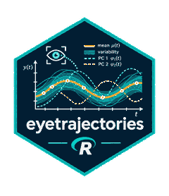

# eyetrajectories



[](https://doi.org/10.5281/zenodo.24288857) [](https://github.com/stefanosbalaskas/eyetrajectories/releases/latest)

**From eye movements to mathematical trajectories.**

*Functional and dynamical analysis of time-varying visual attention in R.*

[Stable GitHub release 0.4.3](https://github.com/stefanosbalaskas/eyetrajectories/releases/tag/v0.4.3) · [Six-platform qualification](https://github.com/stefanosbalaskas/eyetrajectories/actions/runs/43862845556) · [Documentation](https://stefanosbalaskas.github.io/eyetrajectories/) · [Issues](https://github.com/stefanosbalaskas/eyetrajectories/issues)

> **Release status:** Version **0.4.3** is published as a **stable GitHub software release** (not a prerelease). It has **not** been accepted or published by CRAN. The qualified 0.4.3 source is pinned to [commit 20e6db8](https://github.com/stefanosbalaskas/eyetrajectories/commit/20e6db830d480b55456c2acf85e5fdb12cfa398f), while `main` currently contains an older development snapshot. Do not assume that installing the default `main` branch gives the qualified 0.4.3 archive.

**Branding:** [Selected R-package sticker and scalable companion artwork](branding/README.md).

## Why trajectories?

A gaze recording is more than fixation counts or total dwell time. It is a sequence of spatial observations evolving over time, which can be studied using tools from functional data analysis, computational geometry, statistics, and nonlinear dynamics.

A time-indexed gaze path can be written as

$$
\mathbf{x}_i(t) = [x_i(t),\,y_i(t)],
$$

and, more generally, a multivariate trajectory as $\mathbf{x}_i(t)\in\mathbb{R}^p$.

This general mathematical viewpoint is part of the project's inspiration: **what happens when eye movements are treated as trajectories rather than isolated events?** Although many underlying methods apply to other numerical trajectories, this package's scientific scope and examples remain focused on **eye tracking**. It is not an orbital propagation, astrodynamics, or general-purpose physics engine.

## What can it analyse?

| Area | Examples |
| --- | --- |
| **Trajectory representation** | Explicit time grids, multidimensional channels, metadata, validation and preprocessing |
| **Movement and geometry** | Velocity, acceleration, speed, heading, path length and trajectory comparisons |
| **Functional data analysis** | Functional PCA, multivariate FPCA, reconstruction, functional regression and multilevel approaches |
| **Similarity and dynamics** | Integrated $L^2$ distance, dynamic time warping, discrete Fréchet distance, recurrence and nonlinear diagnostics |
| **Sparse and irregular sampling** | Experimental sparse-functional models and explicit resampling workflows |
| **Scientific diagnostics** | Resampling, simulation, uncertainty diagnostics, plots and reporting interfaces |

**Scientific limitations matter.** Some implementations are planar (2D), assume matching time grids, or use experimental statistical inference. Functional equivalence, calibrated confidence bands and generalization to arbitrary measurements should not be assumed without method-specific tests.

## Install the qualified 0.4.3 stable GitHub release

For the independently checked *exact source archive*, use the `eyetrajectories_0.4.3.tar.gz` attachment on the [stable GitHub release](https://github.com/stefanosbalaskas/eyetrajectories/releases/tag/v0.4.3) and verify its SHA-256.

```text
38f7b8eb05c71c3a0c4c266cc590b9afdb73906b0d9412cf52185523f649da5e
```

Alternatively, install the exact source *revision* from GitHub (this is not the byte-identical built source archive):

```r
install.packages("remotes")
remotes::install_github(
  "stefanosbalaskas/eyetrajectories",
  ref = "20e6db830d480b55456c2acf85e5fdb12cfa398f",
  dependencies = NA
)
library(eyetrajectories)
packageVersion("eyetrajectories")
```

Do not use `install.packages("eyetrajectories")` as a CRAN installation instruction unless CRAN has actually accepted and published the package.

## Quick start — native R, without Python

This example uses synthetic mathematical trajectories; it contains **no human participant data**.

```r
library(eyetrajectories)

time <- seq(0, 1, length.out = 81)
values <- array(0, dim = c(8, length(time), 2))

for (i in seq_len(8)) {
  values[i, , 1] <- sin(2 * pi * time + i / 10)
  values[i, , 2] <- cos(2 * pi * time + i / 10)
}

paths <- etr_trajectory_set(
  time,
  values,
  curve_ids = paste0("trial_", seq_len(8)),
  dimension_names = c("x", "y"),
  coordinate_system = "normalized",
  time_unit = "s"
)

fit <- etr_fit_mfpca(paths, n_components = 0.95)
etr_fpca_variance_frame(fit)
head(etr_fpca_scores(fit))

etr_pairwise_l2(paths)
etr_plot_trajectories(paths)
```

Native `etr_*` analyses do not initialize Python. The optional `et_*` and `etpy_*` interfaces can use the separately published [eyetrajectoriespy](https://pypi.org/project/eyetrajectoriespy/) package through `reticulate`.

## API size is not scientific certification

The **0.4.3 release** exports **904 named R functions**, comprising **507 `etr_*` native interfaces**, **383 `etpy_*` Python-facing interfaces** (380 mapped Python callables plus three API helpers), and **14 `et_*` higher-level interfaces**. An exported interface is not necessarily a distinct numerical estimator.

The frozen **508-symbol Python reference inventory** consists of **380 functions and 128 classes/constants/other public symbols**. Matching source APIs or passing automated tests does **not** prove 508 independently certified numerical and scientific equivalents. Advanced inference and cross-domain use remain subject to explicit validation.

## Qualification and transparency

The exact 0.4.3 source archive passed [six GitHub cross-platform R CMD check qualification jobs](https://github.com/stefanosbalaskas/eyetrajectories/actions/runs/43862845556) (Windows release and R-devel, macOS release, Linux release, Linux previous release, and Linux R-devel). A further maintainer-run Windows `R CMD check --as-cran` returned **0 errors, 0 warnings, 1 NOTE** ("New submission").

Passing these checks demonstrates successful package installation, documentation checks, examples, and test execution in the covered environments. It **does not constitute CRAN acceptance or independent scientific validation**.

- [0.4.2 candidate source and release checklist](https://github.com/stefanosbalaskas/eyetrajectories/blob/release/eyetrajectories-0.4.2-rc1-20261116/docs/CRAN_RELEASE_CANDIDATE_0.4.2.md)
- [Scientific vs. source parity](https://github.com/stefanosbalaskas/eyetrajectories/blob/release/eyetrajectories-0.4.2-rc1-20261116/docs/SCIENTIFIC_VS_SOURCE_PARITY.md)
- [Experimental release scope](https://github.com/stefanosbalaskas/eyetrajectories/blob/release/eyetrajectories-0.4.2-rc1-20261116/docs/experimental-release-scope.md)
- [Website work in progress](https://github.com/stefanosbalaskas/eyetrajectories/pull/180)

## Cite the software

**eyetrajectories 0.4.3** is archived on Zenodo with a version-specific DOI:

[**https://doi.org/10.5281/zenodo.24288857**](https://doi.org/10.5281/zenodo.24288857)

Suggested reference:

> Balaskas, S. (2026). *eyetrajectories* (Version 0.4.3) [Computer software]. Zenodo. https://doi.org/10.5281/zenodo.24288857

For reuse of a particular software version, cite the DOI for that version. GitHub also provides a citation file, `CITATION.cff`. The GitHub release is publicly available; CRAN acceptance remains a separate process.

## Project and license

**Maintainer:** Stefanos Balaskas. Contributions and reproducible bug reports are welcome through [GitHub Issues](https://github.com/stefanosbalaskas/eyetrajectories/issues).

Released under the **MIT License**; see [LICENSE](LICENSE).
