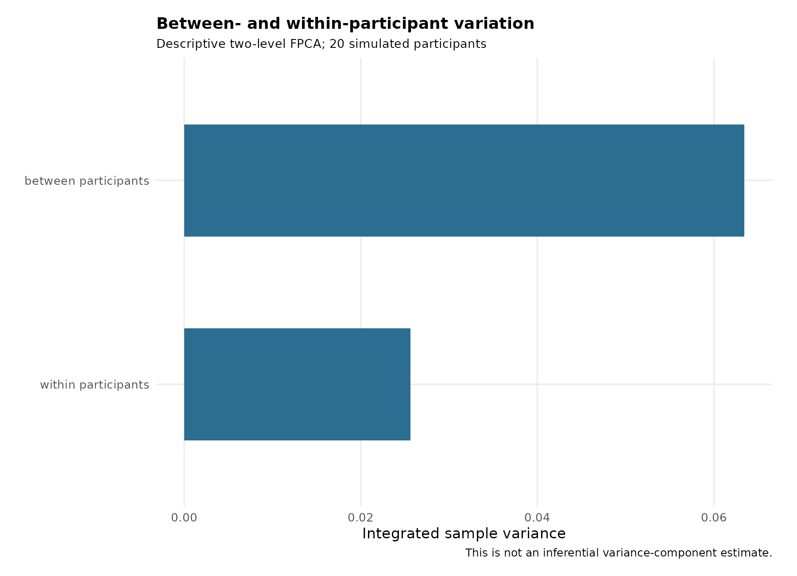
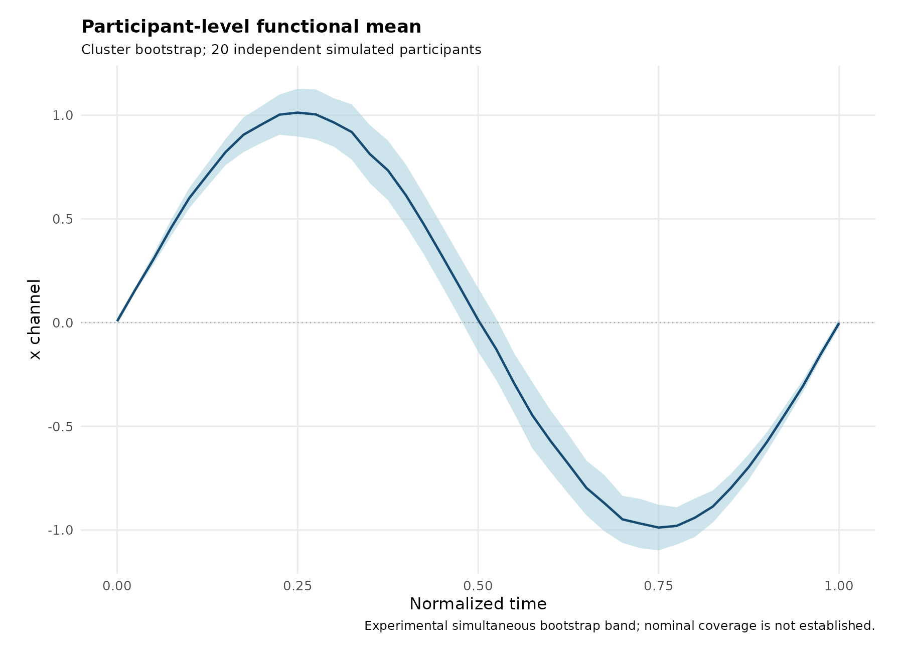
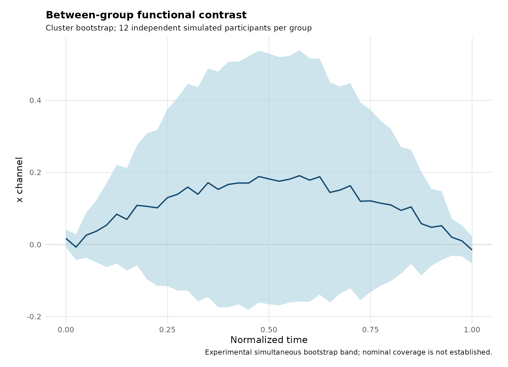
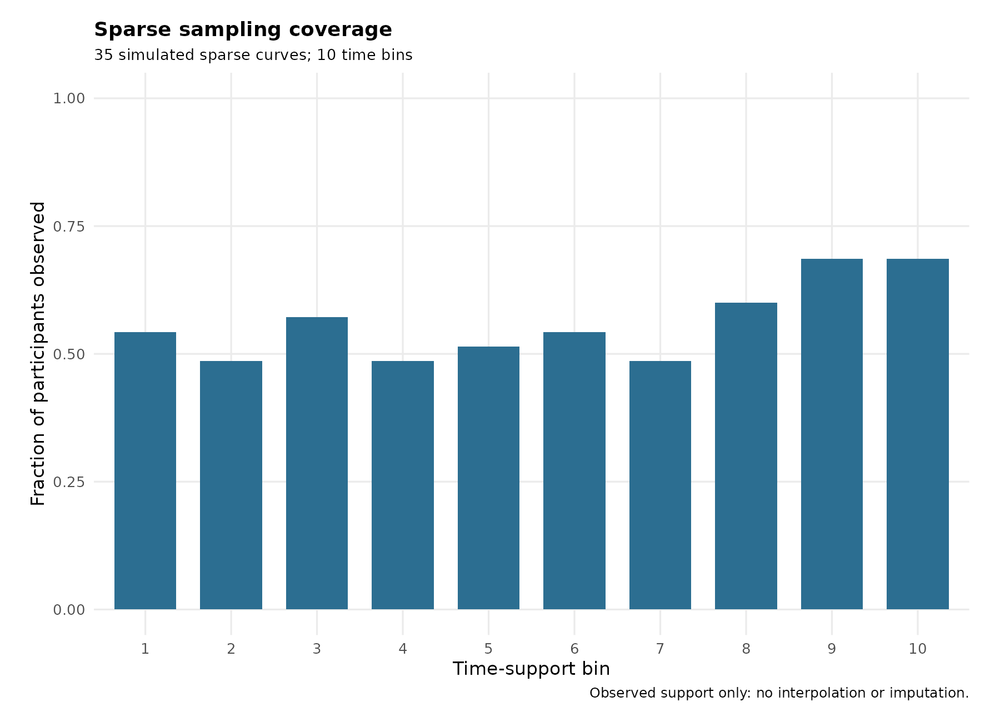
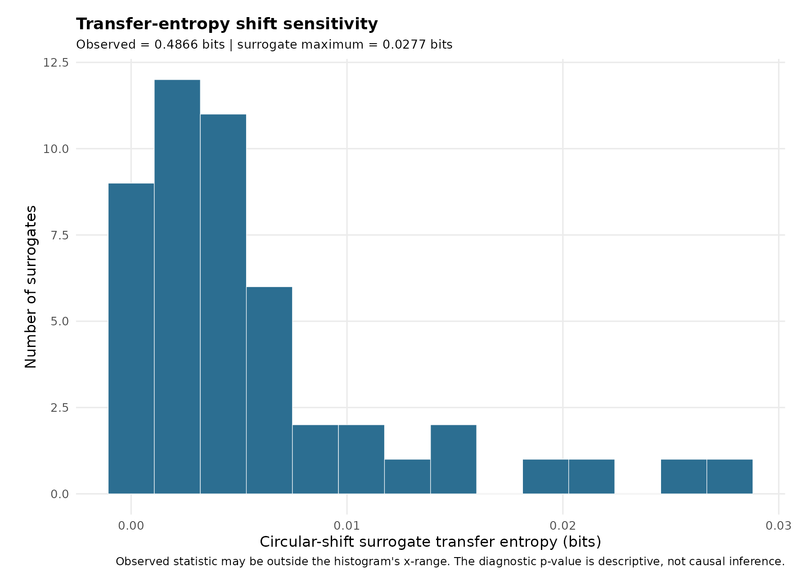

# Scientific figure gallery

FIVE REPRODUCIBLE NATIVE R FIGURES · SYNTHETIC DATA

Explore how functional trajectories, multilevel variability, observation support and nonlinear diagnostics are represented. These are deterministic synthetic examples produced by the actual R research package and its existing figure scripts—not empirical participant recordings, proof of Python numerical parity, or evidence of calibrated statistical inference.

  <figure class="et-figure et-figure-wide">
    
    <figcaption>01 / MULTILEVEL FPCA<h3>Between- and within-participant variation</h3>
Integrated sample variance by stratum from 20 synthetic participants. Descriptive decomposition, <strong>not inferential variance-component estimation</strong>.
<a href="gallery/01_multilevel_variance.png">Open full-resolution figure ↗</a></figcaption>
  </figure>
  <figure class="et-figure">
    
    <figcaption>02 / FUNCTIONAL UNCERTAINTY<h3>Participant-level mean band</h3>
Participant-cluster bootstrap from simulated trajectories. Experimental simultaneous bands have <strong>no general coverage guarantee</strong>.
<a href="gallery/02_participant_mean_band.png">Open full-resolution figure ↗</a></figcaption>
  </figure>
  <figure class="et-figure">
    
    <figcaption>03 / GROUP CONTRASTS<h3>Time-varying group difference</h3>
Participant-resampled comparison between two simulated groups. Interpret the ribbon as experimental, not as validated inferential coverage.
<a href="gallery/03_group_contrast_band.png">Open full-resolution figure ↗</a></figcaption>
  </figure>
  <figure class="et-figure">
    
    <figcaption>04 / SPARSE DATA<h3>Observed sampling support</h3>
Coverage across ten bins from 35 synthetic sparse curves. Describes observed sampling only, <strong>without interpolation or imputation</strong>.
<a href="gallery/04_sparse_support.png">Open full-resolution figure ↗</a></figcaption>
  </figure>
  <figure class="et-figure">
    
    <figcaption>05 / NONLINEAR ANALYSIS<h3>Transfer-entropy shift sensitivity</h3>
Surrogate statistics from a coupled synthetic binary sequence. The observed value can be beyond the histogram limits; <strong>these results are not causal evidence</strong>.
<a href="gallery/05_transfer_entropy_surrogates.png">Open full-resolution figure ↗</a></figcaption>
  </figure>

## Fully reproducible source

These images are generated from the existing package-owned scripts [run_native_ggplot_gallery.R](https://github.com/stefanosbalaskas/eyetrajectories/blob/feat/pkgdown-scientific-site-20261116/scripts/run_native_ggplot_gallery.R) and [run_native_worked_gallery.R](https://github.com/stefanosbalaskas/eyetrajectories/blob/feat/pkgdown-scientific-site-20261116/scripts/run_native_worked_gallery.R), with fixed seeds and a common synthetic dataset. To generate the PNG files for the site, from the R package root:

~~~r
install.packages(c("pkgload", "ggplot2"))
source("scripts/build_pkgdown_gallery.R")
~~~

The source also creates CSV summaries, a PDF figure collection and a qualification manifest under the build-ignored \`artifacts/native_ggplot_gallery/\` folder. The pkgdown site copies only the illustrative PNG files. The gallery does not change scientific estimators or sign off any 508-export source contracts.

For methods and caveats consult [Methods](SITE_METHODS.html) and [Validation](SITE_VALIDATION.html).
